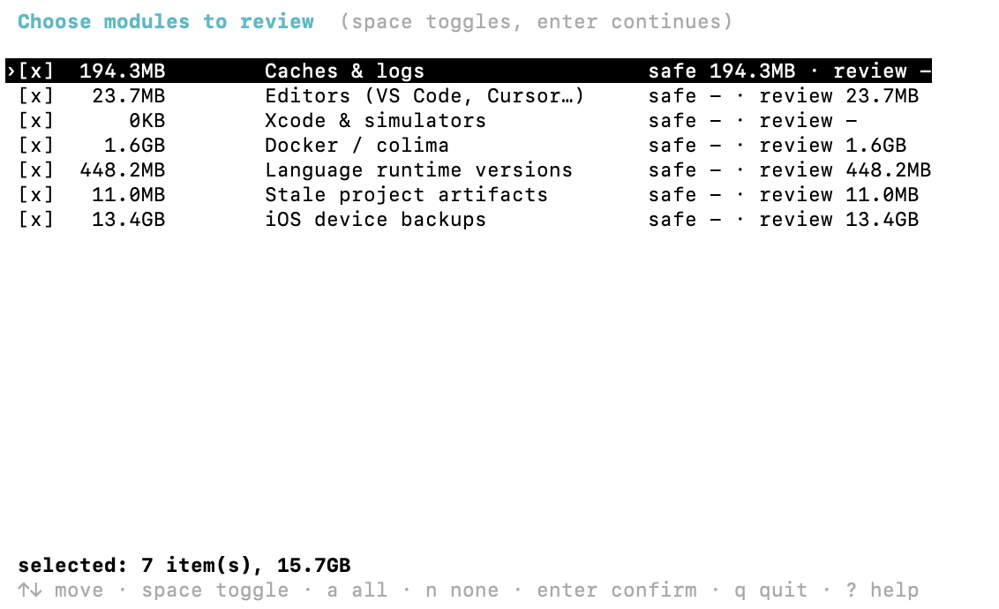

# 🧹 mac-cleanup



`mac-cleanup` scans 19 areas of my Mac (caches, WhatsApp, Docker, Xcode, editors, Claude, dev toolchains, …), shows what can be freed, and lets you review each area in a checkbox list before anything is deleted. It's a single bash file and needs nothing beyond what ships with macOS.

```
mac-cleanup 3.0.0 — Disk: 144Gi used of 228Gi, 56Gi free (72%)

== RESULTS ==
  ✔ Caches & logs                freed 425.6MB  (6 item(s))
  ✔ WhatsApp                     freed 5.5GB  (3 item(s))
  – Xcode & simulators           skipped  (safe 3.9GB · review 18.2GB)
  ✔ Docker / colima              freed 836MB  (2 item(s))
  · nothing to clean: Browsers, GIMP, iOS device backups

== SUMMARY ==
  freed ≈ 6.7GB   (free space change: +6.5GB; APFS may take a minute to report)
```

## Features

- **Dry-run by default.** Nothing is deleted unless you pass `--apply`.
- **You choose.** Each area opens in a full-screen checkbox picker; your data (media,
  simulators, backups, models…) is never pre-selected.
- **Aware of running apps.** Caches of apps that are open are left alone.
- **Guarded deletes.** Every deletion goes through one guard that refuses `/`, your home,
  `~/Library`, `/Applications` and other top-level paths, and is logged.
- **Zero dependencies.** Stock `/bin/bash` 3.2 and built-in macOS tools. `docker`, `brew`,
  `xcrun`, `npm`, `rustup`… are used only if installed.
- **Unattended mode.** `--apply --yes` cleans only regenerable caches, safe for cron/launchd.

## Install

Requires macOS 26 or later. No Homebrew, Python or Xcode needed.

```sh
git clone https://github.com/alessio-signorini/osx-disk-cleanup-script.git
cd osx-disk-cleanup-script
./build.sh                          # -> dist/mac-cleanup (single executable script)
cp dist/mac-cleanup ~/.local/bin/   # or anywhere on your $PATH
```

## Usage

```sh
mac-cleanup                      # dry-run: report everything, delete nothing
mac-cleanup --apply              # review each module and delete what you select
mac-cleanup --apply --yes        # unattended: safe caches and logs only
mac-cleanup whatsapp --apply     # just one module
mac-cleanup --only xcode,docker  # several modules
mac-cleanup --list               # list modules
```

> [!TIP]
> Quit VS Code, Chrome, Claude, WhatsApp and similar apps first, and give your terminal
> **Full Disk Access** so sandboxed caches (Safari, Mail, WhatsApp) can be cleaned.

All options, picker keys, the non-interactive mode and the safety tiers are described in
[docs/USAGE.md](docs/USAGE.md).

## What it cleans

| Module | What it looks at |
|---|---|
| `caches` | `~/Library/Caches`, Logs, Trash, Mail downloads, .ipsw firmware, sandboxed/group container caches, QuickLook |
| `orphans` | containers of apps that are no longer installed |
| `apps` | Electron/Chromium caches per app (VS Code, Slack, Chrome…), krisp, GoogleUpdater |
| `editors` | VS Code/Cursor/Windsurf logs, superseded extensions, orphaned/idle workspace storage |
| `claude` | Claude Code old binaries, debug logs, old history; Claude desktop Cowork sessions and VM |
| `browsers` | Chrome on-device AI model; profile sizes |
| `whatsapp` | logs, unreferenced media per chat, old media per chat |
| `xcode` | DerivedData, simulator caches/runtimes/devices, DeviceSupport, archives |
| `docker` | stopped containers, dangling volumes, unused images, build cache, colima fstrim/rebuild |
| `dev` | npm/pnpm/yarn/pip/uv/go/CocoaPods/bun/cargo/Gradle caches, `~/.cache`, Go module cache |
| `runtimes` | non-current rbenv/pyenv/nvm versions, rust toolchains |
| `projects` | `node_modules`, `.venv`, `target`, `.next`… in projects idle > `--days` |
| `brew` | `brew cleanup`, `brew autoremove` |
| `gimp` | temp/swap files, old version profiles |
| `downloads` | old .dmg/.pkg/.zip/… in Downloads/Desktop, macOS installers |
| `models` | local LLM models in `~/.omlx` |
| `backups` | iOS device backups |
| `system` | (opt-in, sudo) `/Library/Caches`, crash reports, rotated logs, Time Machine local snapshots |
| `report` | read-only: largest folders and files > 1GB that no other module already listed |

## Documentation

- [Usage](docs/USAGE.md) — options, review flow, tiers, safety details
- [Development](docs/DEVELOPMENT.md) — layout, tests, adding a module, sandboxed experiments
- [Specification](docs/BUILD.md) — full design and module specs
